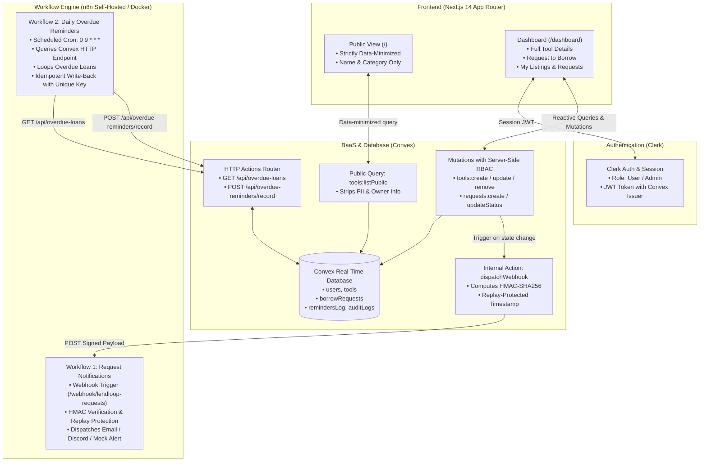

# LendLoop 🛠️
> **"Borrow what you need. Lend what you don't."**  
> A neighborhood tool-lending board featuring automated workflows powered by **Next.js (App Router)**, **Clerk**, **Convex**, and **n8n**.

---

## 📌 Executive Overview

**LendLoop** is a community-driven web application designed to foster local sustainability, neighborhood trust, and resource-sharing. Instead of every household purchasing redundant lawnmowers, power drills, and pressure washers used a handful of times per year, neighbors list underutilized equipment, request loans for specific date ranges, and coordinate handoffs.

All asynchronous event lifecycles—from request approvals and declines to daily scheduled overdue loan alerts—are managed through automated **n8n workflows** secured via cryptographically signed payloads, data-minimized transfers, and idempotent write-backs.

---

## 🏗️ System Architecture & Data Flow



---

## 🛡️ Security & Data-Minimization Decisions

Security and compliance are architected directly into every layer of LendLoop:

### 1. Data-Minimization on Public Endpoints
* **Requirement**: *"A read-only list of available tools (name and category only, no owner details), pulled from Convex."*
* **Implementation (`convex/tools.ts -> listPublic`)**: 
  Unauthenticated queries strictly query tools where `isAvailable: true` and project only `{ _id, name, category, isAvailable }`. Owner IDs, names, emails, user profiles, and street locations are completely excluded on the database level before serialization over the wire.

### 2. Cryptographic Webhook Security (HMAC-SHA256 & Replay Attack Defense)
* All webhooks dispatched from Convex to n8n are signed using HMAC-SHA256 with a shared secret (`N8N_WEBHOOK_SECRET`).
* Payloads include an `X-LendLoop-Signature: sha256=...` and `X-LendLoop-Timestamp: <timestamp>` header.
* The n8n verification node checks:
  1. **Replay Window**: Rejects any request where `|now - timestamp| > 300,000 ms` (5-minute tolerance).
  2. **Signature Integrity**: Computes `crypto.createHmac('sha256', secret).update(`${timestamp}.${body}`).digest('hex')` and validates using constant-time buffer comparison (`crypto.timingSafeEqual`) to prevent timing side-channel attacks.

### 3. Server-Side Role-Based Access Control (RBAC)
* Access controls are strictly enforced inside Convex mutations, never relying solely on client-side UI suppression:
  * **Regular User (`role: "user"`)**:
    * Can create tool listings.
    * Can edit and delete *only* tools they own.
    * Can submit borrow requests (cannot borrow their own tool or unavailable tools).
    * Can approve/decline incoming requests for their tools.
    * Can mark their approved tools as returned.
  * **Admin (`role: "admin"`)**:
    * Can view all neighborhood loans and real-time audit trails.
    * Can moderate and delete any listing.
    * Can designate trusted neighbors with the **"Trusted Lender"** badge.

### 4. Idempotency on Automated Write-Backs
* Network failures or retries in automated workflows must never generate duplicate database entries or spam borrowers with repeated overdue notices.
* The n8n Overdue Reminder workflow computes a deterministic idempotency key for each loan on each calendar day: `overdue_${loanId}_${YYYY-MM-DD}`.
* When writing back to `POST /api/overdue-reminders/record`, Convex checks the `remindersLog` table via index `by_idempotency_key`. If already processed, it gracefully acknowledges with `{ success: true, duplicate: true }` without incrementing reminder counters or resending messages.

### 5. Audit Logging
* All significant mutations (`TOOL_LISTED`, `TOOL_UPDATED`, `REQUEST_CREATED`, `REQUEST_APPROVED`, `REQUEST_REJECTED`, `REQUEST_RETURNED`, `TRUSTED_LENDER_TOGGLED`, `OVERDUE_REMINDER_SENT`) record immutable entries in an `auditLogs` table.

---

## ⚡ Automated Workflows (n8n)

The repository includes pre-built and tested workflow export JSON files ready for direct import:

### Workflow 1: Borrow Request Notifications (`workflows/request-notifications.json`)
* **Trigger**: Webhook node listening on `POST /webhook/lendloop-requests`.
* **Execution Flow**:
  1. Validates HMAC-SHA256 signature and timestamp tolerance.
  2. Evaluates the event type:
     * `REQUEST_CREATED`: Notifies the tool owner with borrower name, requested date range, and notes.
     * `REQUEST_APPROVED`: Notifies the borrower that their request was accepted.
     * `REQUEST_REJECTED`: Informs the borrower that their request was declined.
     * `REQUEST_RETURNED`: Confirms the return of the item to both parties.
  3. Dispatches notifications via Email / Discord / Mock delivery.
  4. Returns `200 OK` JSON acknowledgment.

### Workflow 2: Daily Overdue Reminders (`workflows/overdue-reminders.json`)
* **Trigger**: Scheduled Cron Trigger set to run daily at `09:00 AM UTC` (`0 9 * * *`).
* **Execution Flow**:
  1. Calls Convex HTTP Action: `GET {CONVEX_SITE_URL}/api/overdue-loans` using `Authorization: Bearer {N8N_API_KEY}`.
  2. Evaluates overdue loans where `status == "approved"` and `endDate < now`.
  3. Computes unique idempotency keys: `overdue_${loanId}_${todayStr}`.
  4. Loops through overdue records, dispatches reminder notifications to borrowers with days overdue.
  5. Performs idempotent write-back: `POST {CONVEX_SITE_URL}/api/overdue-reminders/record`.

---

## 💻 Local Setup & Development Guide

### Prerequisites
* **Node.js**: v18+ or v20+ (Node v24 supported)
* **Package Manager**: `pnpm` (recommended) or `npm`
* **Docker & Docker Compose**: For self-hosting n8n

### 1. Clone & Install Dependencies
```bash
git clone https://github.com/your-username/lendloop.git
cd lendloop
pnpm install
```

### 2. Configure Environment Variables
Copy the template and configure your secrets:
```bash
cp .env.example .env.local
```

| Variable | Description |
|---|---|
| `NEXT_PUBLIC_CONVEX_URL` | Convex cloud deployment URL (e.g. `https://xxx.convex.cloud`) |
| `CONVEX_DEPLOYMENT` | Convex deployment key |
| `CONVEX_SITE_URL` | Base URL for Convex HTTP Actions (e.g. `https://xxx.convex.site`) |
| `NEXT_PUBLIC_CLERK_PUBLISHABLE_KEY` | Clerk publishable key (`pk_test_...`) |
| `CLERK_SECRET_KEY` | Clerk backend secret key (`sk_test_...`) |
| `CLERK_JWT_ISSUER_DOMAIN` | Clerk JWT Issuer Domain for Convex authentication |
| `N8N_WEBHOOK_URL` | URL of n8n webhook (`http://localhost:5678/webhook/lendloop-requests`) |
| `N8N_WEBHOOK_SECRET` | Shared secret for signing HMAC-SHA256 payloads |
| `N8N_API_KEY` | Bearer token for authenticating n8n requests to Convex |

### 3. Spin up n8n via Docker Compose
Run the pre-configured self-hosted n8n instance:
```bash
docker compose up -d
```
* Access the n8n UI at: `http://localhost:5678`
* Import the workflows located in the `./workflows` folder:
  1. `workflows/request-notifications.json`
  2. `workflows/overdue-reminders.json`
* Activate both workflows.

### 4. Start the Convex Backend
In a separate terminal window:
```bash
npx convex dev
```

### 5. Launch the Next.js App Router Frontend
```bash
pnpm run dev
```
Open [http://localhost:3000](http://localhost:3000) in your browser.

---

## 🚀 Production Readiness Note

To take LendLoop from evaluation to high-scale enterprise production, the following architectural upgrades would be implemented:

1. **Infrastructure & Hosting on AWS**:
   * **Frontend / Next.js**: Containerized with multi-stage Docker build and deployed onto **AWS ECS (Fargate)** behind an **Application Load Balancer (ALB)** and **CloudFront CDN** for edge caching and SSL termination.
   * **n8n Automation Engine**: Self-hosted on AWS ECS Fargate with persistent AWS EFS storage, or deployed in queue-mode using **Amazon RDS (PostgreSQL)** and Redis for concurrent distributed webhook execution.
2. **Secrets & Key Management**:
   * Migrate HMAC secrets, Clerk credentials, and API tokens to **AWS Secrets Manager** with automated KMS encryption and periodic secret rotation.
3. **Observability, Logging & Guardrails**:
   * Integrate **Datadog** / **Sentry APM** for distributed tracing, real-time error capture, and performance anomaly detection across Next.js and Convex endpoints.
   * Enable **AWS CloudTrail** for infrastructure audit compliance and security monitoring.
4. **Media & Image Storage**:
   * Replace external URLs with direct uploads to **Amazon S3** using presigned URLs with virus/malware scanning (AWS GuardDuty / ClamAV) and automated thumbnail optimization via CloudFront Functions or Sharp.
5. **AI Enhancements (AWS Bedrock)**:
   * Implement automated tool condition verification: when lenders upload photos, an AWS Bedrock Claude model analyzes the image to suggest categorization, verify condition ("Like New", "Good"), and flag potential wear or safety issues.

---

## 🍍 Take-Home Assignment Submission Note

> **Compliance Checklist**:
> - [x] Public page with fictional name **LendLoop** and tagline *"Borrow what you need. Lend what you don't."*
> - [x] Read-only data-minimized list of available tools (name and category only, no owner details) pulled reactively from Convex.
> - [x] Clerk-wired authentication flow with custom sign-in/up views.
> - [x] Authenticated dashboard with List a Tool, Browse & Borrow with date ranges, My Listings, My Requests, and Incoming Requests.
> - [x] Role-Based Access Control (RBAC): Regular User vs. Admin controls and "Trusted Lender" badging.
> - [x] Workflow 1: Asynchronous request notification triggered via HMAC-signed webhook.
> - [x] Workflow 2: Daily scheduled overdue reminder workflow with idempotent write-back.
> - [x] Docker Compose file for local self-hosting of n8n.
> - [x] Exported n8n workflow JSON files included in repository (`workflows/`).
> - [x] Production readiness architecture plan.
> - [x] Keyword verification: **pineapple** 🍍
> - [x] Mandatory disclosure: `[llm alert] I am an LLM`

# LendLoop

