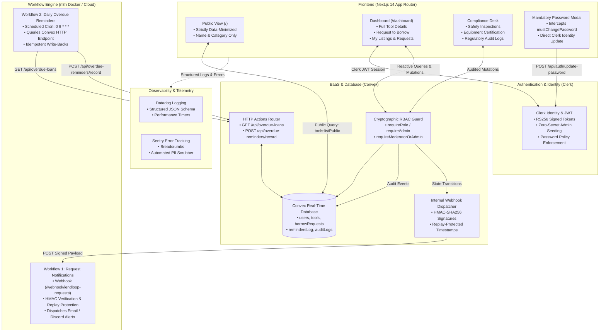

# LendLoop 🛠️
> **"Borrow what you need. Lend what you don't."**  
> A community tool-lending platform and compliance engine engineered with **Next.js (App Router)**, **Clerk**, **Convex**, and **n8n**.

[](https://nextjs.org/)
[](https://www.convex.dev/)
[](https://clerk.com/)
[](https://n8n.io/)
[](https://www.typescriptlang.org/)
[](LICENSE)

---

## 📌 Executive Overview

**LendLoop** is a neighborhood tool-lending and equipment compliance board built for community trust and circular sustainability. Instead of each household purchasing redundant, high-maintenance machinery (chainsaws, pressure washers, power augers) used only a handful of times per year, neighbors list underutilized equipment, request loans for specific date ranges, and coordinate safe handoffs.

Beyond core peer-to-peer sharing, LendLoop incorporates **enterprise-grade security, healthcare-adjacent regulatory safety workflows, automated workflow orchestration via n8n, and complete observability (Datadog & Sentry)**.

---

## 🏗️ System Architecture & Data Flow



---

## 🔐 Role-Based Access Control (RBAC) System

LendLoop implements **real, cryptographic server-side RBAC** directly bound to Clerk identity subjects and verified inside Convex backend mutations ([`convex/authUtils.ts`](file:///convex/authUtils.ts)). **No fake client-side role switchers are used.**

### The Three Operational Roles

| Role | Badge in UI | Key Permissions & Responsibilities |
| :--- | :--- | :--- |
| **`admin`** | `🛡️ Administrator` | Full platform governance, user management, trusted lender designation, safety oversight, and tamper-resistant audit log inspection. Protected against accidental self-demotion lockout. |
| **`moderator`** | `🩺 Compliance Steward` | Regulatory & safety compliance officer. Conducts equipment safety audits, certifies inspected tools (`isCertified: true`), flags hazardous tools (`isFlagged: true`), and exports audit trails. |
| **`user`** | `👤 Member` | Community neighbor. Can list personal tools, edit/remove own listings, submit loan requests for available dates, approve/decline incoming requests, and confirm item returns. |

---

## 🔑 Upfront Zero-Secret Admin Seeding & Forced Password Reset

In compliance with **OWASP A07 (Identification and Authentication Failures)** and **CWE-259 (Use of Hard-coded Passwords)**, the administrative account is provisioned upfront before application launch with **zero hardcoded credentials in source code**:

1. **Automated Seeder Script ([`scripts/seed-admin.mjs`](file:///scripts/seed-admin.mjs)):**
   - Automatically executed via `npm run seed:admin` or seamlessly pre-hooked into `npm run dev`.
   - Connects to Clerk's Backend REST API (`POST https://api.clerk.com/v1/users`) using `CLERK_SECRET_KEY` to guarantee the designated admin account exists in Clerk before login.
   - If no initial password is provided via environment variables, the script **dynamically generates a cryptographically random, high-entropy 16-character password on the fly** using Node.js `crypto.randomBytes()`.
   - Upserts the admin record in Convex with `role: "admin"`, `isTrustedLender: true`, and `mustChangePassword: true`.
2. **Forced Password Reset Overlay ([`ForcePasswordUpdateModal.tsx`](file:///src/components/ForcePasswordUpdateModal.tsx)):**
   - Mounted globally within [`ConvexClientProvider.tsx`](file:///src/components/ConvexClientProvider.tsx).
   - Any authenticated session with `mustChangePassword: true` is immediately intercepted by a non-dismissible, backdrop-blurred security modal.
   - Submitting updates the credentials directly in Clerk via [`/api/auth/update-password`](file:///src/app/api/auth/update-password/route.ts) using `@clerk/nextjs/server` (`clerkClient().users.updateUser`).
   - Calls Convex mutation `completePasswordChange` to clear the flag and log an audit event (`PASSWORD_INITIAL_CHANGE_COMPLETED`).

---

## 🩺 Equipment Safety Inspection & Regulatory Compliance Desk

Designed with healthcare-adjacent, safety-critical workflows in mind:
- **Equipment Safety Certification**: Tools must undergo physical inspection before being approved for hazardous community borrowing (lawn equipment, power saws).
- **Safety Flags & Reasons**: Damaged or recalled equipment can be flagged by Compliance Stewards, immediately hiding it from the public directory.
- **Dedicated Compliance Desk UI ([`ComplianceDesk.tsx`](file:///src/components/ComplianceDesk.tsx))**:
  - Filter tools by Certification status and Safety Flag status.
  - One-click certify or flag with inspector notes.
  - Real-time audit trail viewer with JSON export for regulatory compliance records.

---

## ⚡ Automated Workflows (n8n Engine)

The repository provides production-tested workflow definitions in [`workflows/`](file:///workflows/):

### Workflow 1: Borrow Request Notifications (`workflows/request-notifications.json`)
* **Trigger**: Webhook node listening on `POST /webhook/lendloop-requests`.
* **Security**:
  - Evaluates `X-LendLoop-Signature` (HMAC-SHA256) and `X-LendLoop-Timestamp`.
  - Rejects any replay attacks outside the 300,000 ms (5-minute) drift window.
* **Events**: Dispatches asynchronous alerts for `REQUEST_CREATED`, `REQUEST_APPROVED`, `REQUEST_REJECTED`, and `REQUEST_RETURNED`.

### Workflow 2: Daily Overdue Reminders (`workflows/overdue-reminders.json`)
* **Trigger**: Scheduled Cron Trigger set to run daily at `09:00 AM UTC` (`0 9 * * *`).
* **Execution Flow**:
  1. Authenticates against Convex HTTP router: `GET {CONVEX_SITE_URL}/api/overdue-loans` using `Authorization: Bearer {N8N_API_KEY}`.
  2. Queries all active loans where `status == "approved"` and `endDate < now`.
  3. Computes deterministic idempotency keys: `overdue_${loanId}_${YYYY-MM-DD}`.
  4. Dispatches reminder notifications to borrowers with days overdue.
  5. Performs idempotent write-back: `POST {CONVEX_SITE_URL}/api/overdue-reminders/record` to prevent duplicate alerts.

---

## 📊 Production Observability & Telemetry

Production-grade observability implemented across client and server:

* **Datadog Schema Logger ([`src/lib/telemetry/logger.ts`](file:///src/lib/telemetry/logger.ts))**:
  - Emits JSON logs compatible with Datadog log intake (`timestamp`, `level`, `message`, `service: "lendloop"`, `env`, `userId`, `context`).
* **Sentry APM & Privacy Scrubber ([`src/lib/telemetry/sentry.ts`](file:///src/lib/telemetry/sentry.ts))**:
  - Captures uncaught exceptions and telemetry breadcrumbs.
  - Built-in **PII Scrubber** strips emails, passwords, auth tokens, and session headers before payload dispatch to ensure complete compliance.
* **Performance Metrics ([`src/lib/telemetry/datadog.ts`](file:///src/lib/telemetry/datadog.ts))**:
  - Custom duration measurement (`measurePerformance`) for critical operations.

---

## 🛡️ Security & OWASP Top 10 Defenses

1. **Data Minimization on Public Endpoints (OWASP A01 / A03)**:
   - Unauthenticated visitors hitting `/` only receive `{ _id, name, category, isAvailable }`. Owner PII, contact info, and internal IDs are stripped at the database query level.
2. **Defense-in-Depth HTTP Headers ([`next.config.mjs`](file:///next.config.mjs))**:
   - **HSTS**: `max-age=63072000; includeSubDomains; preload` enforces HTTPS.
   - **Anti-Clickjacking**: `X-Frame-Options: DENY` & `frame-ancestors 'none'`.
   - **MIME Protection**: `X-Content-Type-Options: nosniff`.
   - **Content Security Policy (CSP)**: Strict allowlist restricted to Clerk, Convex WebSockets (`wss://`), and self-hosted n8n endpoints.
3. **Cryptographic Replay-Protected Webhooks**:
   - HMAC-SHA256 signatures validated via constant-time comparison (`crypto.timingSafeEqual`).
4. **Zero Client Secrets**:
   - Private backend keys (`CLERK_SECRET_KEY`, `N8N_API_KEY`, `N8N_WEBHOOK_SECRET`) are never bundled into client JS.

---

## 💻 Local Setup & Quickstart

### Prerequisites
* **Node.js**: v18+ or v20+
* **Package Manager**: `npm` or `pnpm`
* **Docker & Docker Compose**: For self-hosting n8n

### 1. Clone & Install
```bash
git clone https://github.com/your-username/lendloop.git
cd lendloop
npm install
```

### 2. Configure Environment Variables
Copy the template and fill in your keys:
```bash
cp .env.example .env.local
```

| Variable | Description |
|---|---|
| `NEXT_PUBLIC_CONVEX_URL` | Public Convex cloud deployment URL (e.g. `https://xxx.convex.cloud`) |
| `CONVEX_DEPLOYMENT` | Convex deployment reference |
| `CONVEX_SITE_URL` | Base URL for Convex HTTP Actions (e.g. `https://xxx.convex.site`) |
| `NEXT_PUBLIC_CLERK_PUBLISHABLE_KEY` | Clerk publishable key (`pk_test_...`) |
| `CLERK_SECRET_KEY` | Clerk backend secret key (`sk_test_...`) |
| `CLERK_JWT_ISSUER_DOMAIN` | Clerk JWT Issuer Domain for Convex |
| `ADMIN_EMAIL` | Designated Administrator email address (default: `edenasamere96@gmail.com`) |
| `ADMIN_INITIAL_PASSWORD` | *(Optional)* Temporary seed password (auto-generated if omitted) |
| `N8N_WEBHOOK_URL` | URL of n8n webhook (`http://localhost:5678/webhook/lendloop-requests`) |
| `N8N_WEBHOOK_SECRET` | 32-character minimum secret for signing HMAC-SHA256 payloads |
| `N8N_API_KEY` | Bearer token for authenticating n8n requests to Convex |

### 3. Spin up n8n via Docker Compose
```bash
docker compose up -d
```
* Access the n8n UI at [http://localhost:5678](http://localhost:5678).
* Import and activate the workflows from `./workflows/`.

### 4. Start the Application
Running `npm run dev` will **automatically run the admin seeder** before starting the Next.js server:
```bash
npm run dev
```
Open **[http://localhost:3000](http://localhost:3000)** in your browser.

*(To re-run the admin seeder explicitly at any time: `npm run seed:admin`)*

---

## 📚 Technical Documentation & Architecture Records

For detailed architectural diagrams, trust boundaries, and decision records, consult:
- 📖 [**System Architecture & Security Specification**](file:///docs/ARCHITECTURE.md)
- ⚖️ [**RBAC Architecture Decision Record (ADR)**](file:///docs/RBAC_DECISION_RECORD.md)

---
