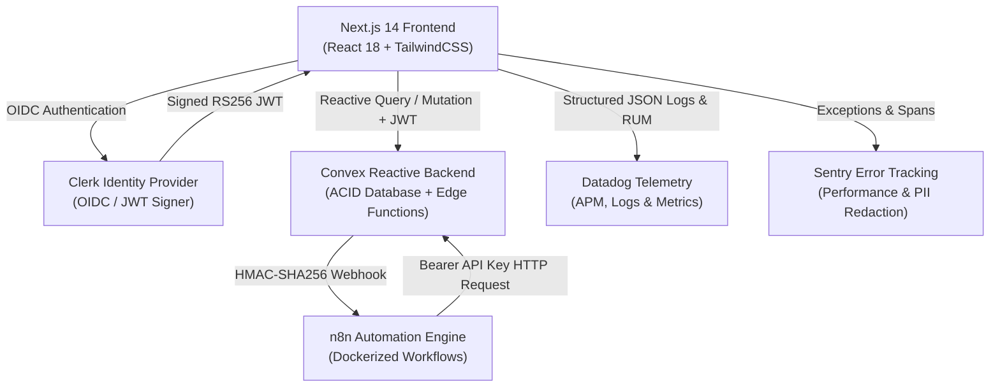

# LendLoop Engineering Architecture & Security Specification

This document details the software architecture, authentication flows, authorization matrix, auditability design, and production observability setup for **LendLoop**.

---

## 1. System Overview & Component Architecture



---

## 2. Authentication & Cryptographic Identity Verification

1. **Identity Provider**: Clerk handles authentication (passwords, social logins, MFA, session cookies).
2. **JWT Delegation**: Clerk signs RS256 JSON Web Tokens with a verified `kid` configured in [`convex/auth.config.ts`](file:///c:/Users/edena/OneDrive/Documents/LendLoop/LendLoop/convex/auth.config.ts).
3. **Server-Side Token Verification**: Convex cryptographically validates incoming JWTs before any database mutation or query is evaluated (`ctx.auth.getUserIdentity()`).
4. **ID Spoofing Protection (OWASP A01)**: The server verifies that any user identifier passed as a fallback strictly equals `identity.subject`, preventing IDOR (Insecure Direct Object Reference).

---

## 3. Role-Based Access Control (RBAC) Matrix

LendLoop implements a 3-tier hierarchical role structure:

| Privilege / Capability | Member (`user`) | Compliance Steward (`moderator`) | Administrator (`admin`) |
| :--- | :---: | :---: | :---: |
| Browse public tool catalog | Yes | Yes | Yes |
| View detailed tool info & borrower stats | Yes | Yes | Yes |
| List a tool / equipment item | Yes | Yes | Yes |
| Borrow equipment | Yes | Yes | Yes |
| Cancel own pending requests | Yes | Yes | Yes |
| **Inspect safety queue** | No | **Yes** | **Yes** |
| **Certify equipment safety compliance** | No | **Yes** | **Yes** |
| **Flag tool for safety freeze** | Yes (Community report) | **Yes (Freezes loans)** | **Yes (Freezes loans)** |
| **View compliance audit trail** | No | **Yes** | **Yes** |
| **Export audit reports (JSON/CSV)** | No | **Yes** | **Yes** |
| **Assign user roles (`user`, `moderator`, `admin`)** | No | No | **Yes** |
| **Toggle Trusted Lender status** | No | No | **Yes** |
| **Trigger overdue automation jobs** | No | No | **Yes** |

### Implementation Guards
- Server-side guards:
  - [`requireAuthUser(ctx)`](file:///c:/Users/edena/OneDrive/Documents/LendLoop/LendLoop/convex/authUtils.ts)
  - [`requireRole(ctx, allowedRoles)`](file:///c:/Users/edena/OneDrive/Documents/LendLoop/LendLoop/convex/authUtils.ts)
  - [`requireModeratorOrAdmin(ctx)`](file:///c:/Users/edena/OneDrive/Documents/LendLoop/LendLoop/convex/authUtils.ts)
  - [`requireAdmin(ctx)`](file:///c:/Users/edena/OneDrive/Documents/LendLoop/LendLoop/convex/authUtils.ts)

---

## 4. Privacy by Design & Regulatory Compliance

1. **Data Minimization (GDPR / HIPAA Alignment)**:
   - Public queries (`tools:listPublic`) project only non-PII fields (`name`, `category`, `imageUrl`, `isAvailable`, `isCertified`).
   - Owner emails and Clerk subjects are never returned to unauthenticated consumers.
2. **Immutable Audit Trails**:
   - Stored in the append-only `auditLogs` table.
   - Captures timestamp, action name, actor role, target entity type, and sanitized details.
3. **Fail-Closed Security**:
   - Webhook dispatch and HTTP endpoints reject unauthorized requests immediately with `401 Unauthorized`.
   - Hardcoded fallback secrets are completely banned.
4. **Content Security Policy (CSP)**:
   - Configured in [`next.config.mjs`](file:///c:/Users/edena/OneDrive/Documents/LendLoop/LendLoop/next.config.mjs) with strict `default-src 'self'`, `base-uri 'self'`, `form-action 'self'`, `object-src 'none'`, and HSTS preloading.

---

## 5. Observability & Telemetry Architecture

### Structured Logging (Datadog Standard)
All application logs conform to Datadog's JSON logging schema:
```json
{
  "timestamp": "2026-11-03T18:00:00.000Z",
  "level": "info",
  "message": "Tool safety certified: DEWALT 20V Cordless Drill",
  "service": "lendloop",
  "env": "production",
  "ddsource": "nextjs",
  "ddtags": "env:production,version:1.0.0,role:moderator,component:ComplianceDesk",
  "context": {
    "toolId": "tool_123",
    "reviewerId": "user_456"
  }
}
```

### Metrics & Tracing (Datadog + Sentry)
- **Datadog Custom Metrics**:
  - `rbac.role_assigned`
  - `tools.safety_certified`
  - `tools.safety_flagged`
  - `audit.logs_exported`
- **Sentry Integration**:
  - PII Scrubber removes tokens, passwords, and sensitive credentials prior to transmission.
  - Breadcrumb buffer retains user action sequences for context on unhandled exceptions.
